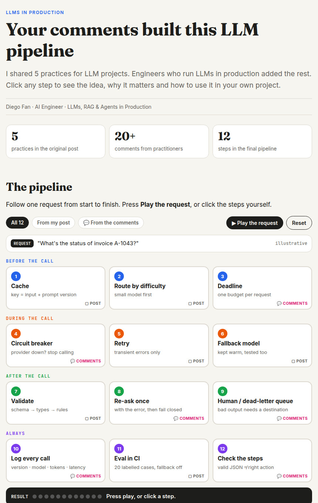

# The Community LLM Pipeline

**12 practices for running LLMs in production, built together with the engineers who use them.**

I shared 5 practices for LLM projects on LinkedIn. More than 20 people who run LLMs in production replied, and almost every comment added something I hadn't listed. This page puts all of it in order, from before the model call to after it.

**👉 Live page: https://diegofan-code.github.io/llm-pipeline-community/**

[](https://diegofan-code.github.io/llm-pipeline-community/)

## The 12 steps

Click a step to open it on the live page. For each step you get the idea, why it matters, how to apply it in your own project, and minimal code.

| # | Step | In one line | Source |
|---|---|---|---|
| | **Before the call** | | |
| 1 | [Cache](https://diegofan-code.github.io/llm-pipeline-community/#step-1) | Key = input + prompt version, so a new prompt never serves old answers | Post |
| 2 | [Route by difficulty](https://diegofan-code.github.io/llm-pipeline-community/#step-2) | Small model first; set the threshold on the eval | Post |
| 3 | [Deadline](https://diegofan-code.github.io/llm-pipeline-community/#step-3) | One time budget per request; retries only use the time left | 💬 Comments |
| | **During the call** | | |
| 4 | [Circuit breaker](https://diegofan-code.github.io/llm-pipeline-community/#step-4) | Provider down? Stop calling it and go straight to the fallback | 💬 Comments |
| 5 | [Retry](https://diegofan-code.github.io/llm-pipeline-community/#step-5) | Only transient errors, with backoff | Post |
| 6 | [Fallback model](https://diegofan-code.github.io/llm-pipeline-community/#step-6) | Kept warm, and tested too | Post |
| | **After the call** | | |
| 7 | [Validate](https://diegofan-code.github.io/llm-pipeline-community/#step-7) | Schema → types → business rules, before the next step | Post |
| 8 | [Re-ask once](https://diegofan-code.github.io/llm-pipeline-community/#step-8) | Send the validation error back, then fail closed | 💬 Comments |
| 9 | [Human / dead-letter queue](https://diegofan-code.github.io/llm-pipeline-community/#step-9) | A bad output needs a destination when retries run out | 💬 Comments |
| | **Always** | | |
| 10 | [Log every call](https://diegofan-code.github.io/llm-pipeline-community/#step-10) | Prompt version, model, tokens, latency, retries | 💬 Comments |
| 11 | [Eval in CI](https://diegofan-code.github.io/llm-pipeline-community/#step-11) | 20 labelled cases next to the prompt, with fallback off | Post |
| 12 | [Check the steps](https://diegofan-code.github.io/llm-pipeline-community/#step-12) | For agents, valid JSON isn't the right action | 💬 Comments |

## New to this? Start here

Twelve steps is a lot for a small project. This order pays off fastest:

1. **Validate the output** (step 7). One Pydantic model and one re-ask fix most broken JSON.
2. **Log every call** (step 10). A few lines of code make every incident debuggable.
3. **Add 20 eval cases** (step 11). Every prompt change now gets a score.

## What the page does

- **Play the request:** follows one example request through all 12 steps.
- **Filters:** shows only the practices from the original post, or only the ones added in the comments.
- **Deep links:** `#step-3` opens step 3 directly, which makes it easy to share one idea.
- **Checklist:** tick what your project already does and copy it as Markdown. The ticks stay in your browser only.

## Roadmap: a page the community keeps building

The plan is to let the page grow with new practices from the community, with every contribution reviewed before it goes live.

- [x] **v0:** interactive static page (this version)
- [ ] **v1:** comments on each step, through GitHub Discussions
- [ ] **v2:** "Suggest a practice" form. Suggestions are stored as *pending*, pre-checked by an LLM, and published only after a human review.
- [ ] **v3:** "This helped me" votes, one page per practice, and a weekly summary of what's new

## How to contribute

- **Suggest a practice or a correction:** open an [issue](https://github.com/diegofan-code/llm-pipeline-community/issues) or reply to my LinkedIn post.
- **Found a mistake in the code samples?** Pull requests are welcome.

Every suggestion is reviewed before it's added. Ideas are rewritten in plain words, and names are shown only for people who ask to be credited.

## Run it locally

It's a single static file with no build step and no dependencies. Clone the repo and open `index.html` in your browser.

```bash
git clone https://github.com/diegofan-code/llm-pipeline-community.git
cd llm-pipeline-community
xdg-open index.html     # Linux. macOS: open index.html
```

## Credits

The practices marked 💬 came from comments on my LinkedIn post. I rewrote them in my own words and left out names. Thank you to everyone who joined the conversation.

Related: [The Two-Judge Loop (VERA)](https://diegofan-code.github.io/VERA/), my agent evaluation loop compared with the ACE paper.

**Diego Fan** · AI Engineer · LLMs, RAG & Agents in production
